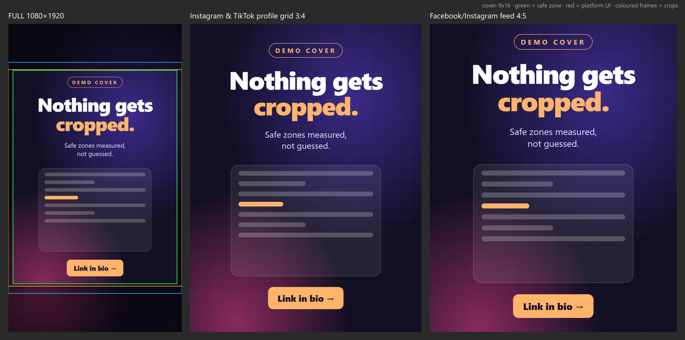
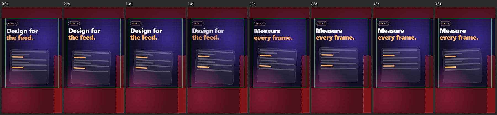

# CropProof

**Social media design & QA skill for Claude — nothing gets cropped, nothing hides behind the buttons.**

CropProof turns Claude into a social media designer, art director and copywriter that **measures** its own work before delivering it: exact platform sizes, safe zones, profile-grid and feed crops, video checks and small file sizes — for Instagram, TikTok, Facebook, YouTube, LinkedIn and X.

> A beautiful design that gets cropped when uploaded is a failed design.
> A correctly sized design with text hidden behind the like button is a failed design too.


*`check-image.mjs` output: the full cover with the safe zone, then exactly what the profile grid (3:4) and the feed (4:5) will show.*


*`check-video.mjs` output: frames across the reel with the platform UI zones (top bar, caption area, action buttons) overlaid.*

## Why

Most social media skills write posts. CropProof also **checks** them, with real measurements instead of "looks fine to me":

- **Measured safe zones** — positions of headlines, logos and CTAs are measured in the rendered design (static *and* animated, every 0.1 s), not eyeballed.
- **Crop previews** — see the asset exactly as the Instagram/TikTok grid (3:4) and the feed (4:5) will show it.
- **Video QA** — dimensions, fps, H.264/yuv420p/AAC/MP4/faststart, black frames, flashes (sudden brightness jumps), hard cuts.
- **Small files, same look** — videos ≤ 15 MB and images ≤ 500 KB, with SSIM quality measurement (e.g. 58 MB → 10 MB, SSIM 0.976).
- **Human copy** — separate captions per platform, current hashtag rules (Instagram: max 5), no invented claims, no "unleash / elevate / next level".
- **No guessing** — every preset is marked tested/untested; untested specs must be verified and flagged.

## Install

Requirements: [Claude Code](https://claude.com/claude-code), Node.js ≥ 20, git.

The skill lives in [`.claude/skills/cropproof`](.claude/skills/cropproof). Skill URL for importers:
`https://github.com/jet1x/CropProof/tree/main/.claude/skills/cropproof`

**macOS / Linux** — install for all your projects
```bash
git clone https://github.com/jet1x/CropProof.git
mkdir -p ~/.claude/skills && cp -r CropProof/.claude/skills/cropproof ~/.claude/skills/
cd ~/.claude/skills/cropproof/tools
npm install && npm run setup && npm test
```

**Windows (PowerShell)** — install for all your projects
```powershell
git clone https://github.com/jet1x/CropProof.git
New-Item -ItemType Directory -Force "$HOME\.claude\skills" | Out-Null
Copy-Item -Recurse CropProof\.claude\skills\cropproof "$HOME\.claude\skills\"
cd "$HOME\.claude\skills\cropproof\tools"
npm install; npm run setup; npm test
```

**One project only:** copy `.claude/skills/cropproof` into `<your-project>/.claude/skills/`, then run the same `npm` commands in its `tools/` folder.

- `npm run setup` downloads the headless Chromium used for measuring HTML designs.
- `npm test` runs the self-test (9 checks: correct assets must pass, deliberately broken ones must fail).
- The tools use `sharp`, `playwright` and `ffmpeg-static` (~110 MB in `tools/node_modules`). If your npm blocks install scripts and ffmpeg is missing, run `npm rebuild ffmpeg-static`, or set `FFMPEG_PATH` to your own ffmpeg.

## Use

Just ask Claude for social media content — the skill loads automatically:

```
Make an Instagram + TikTok reel and covers announcing my new web app, with captions.
Create a YouTube thumbnail and a LinkedIn post for my case study.
Check this cover before I upload it: ./cover.png
```

Or call it directly with `/cropproof`.

Claude will: identify platforms and placements → verify specs → design → **run the measuring tools and fix until everything passes** → review the QC sheets → compress → deliver files with a QC report and per-platform captions & hashtags.

## Tools

Run from `.claude/skills/cropproof/tools/` (Claude runs them for you; you can too):

| Command | What it does |
|---|---|
| `node check-html.mjs <design.html> --preset <p> [--step 0.1]` | Measures protected elements in an HTML design (static or animated) vs safe zone, UI overlays, clipping, obstacles |
| `node check-image.mjs <image> --preset <p>` | Dimensions, format, sRGB, file size + crop/safe-zone sheet in `_qc/` |
| `node check-video.mjs <video.mp4> --preset <p>` | Specs, size, black frames, flashes, hard cuts + frame sheet with UI zones |
| `node compress.mjs <file> [--max-mb 15 \| --max-kb 500]` | Compresses with quality measurement; never overwrites the original |

Every tool prints ✓ / ⚠ / ✗ and `RESULT: PASS | FAIL` (exit code 1 on FAIL), so it fits in scripts and CI.

### HTML contract (for exact measurements)
- `data-check` on protected elements (headline, logo, CTA, URL…)
- `window.ready = true` when fonts/3D/images are loaded
- animations: `window.DURATION` (seconds) + `window.renderAt(t, { noRender })`
- optional `window.obstacles()` → `[{ name, x, y, w, h }]` — things text must not cover (device screens, faces)

### Presets (`tools/specs.json`)

| Preset | Size | For |
|---|---|---|
| `reel-9x16` | 1080×1920 | TikTok, Instagram Reels, Facebook Reels, YouTube Shorts (TikTok-strict safe zone) |
| `cover-9x16` | 1080×1920 | Reel / TikTok covers — content kept inside both the 3:4 grid and 4:5 feed crops |
| `story-9x16` | 1080×1920 | Instagram / Facebook Stories |
| `ig-feed-3x4` | 1080×1440 | Instagram feed — fills the profile-grid tile exactly |
| `ig-feed-4x5` | 1080×1350 | Instagram / Facebook feed portrait |
| `ig-feed-1x1` | 1080×1080 | Feed square (warning: the 3:4 grid cuts the sides) |
| `yt-thumbnail` | 1280×720 | YouTube thumbnail (duration badge zone) |
| `yt-banner` | 2560×1440 | YouTube banner (official 1546×423 safe area) |
| `fb-page-cover`* | 1640×624 | Facebook Page cover (desktop vs mobile crops) |
| `linkedin-banner`* | 1584×396 | LinkedIn profile banner (profile-photo overlap) |
| `x-header`* | 1500×500 | X header (profile-photo overlap) |

\* untested — approximate values; Claude verifies them against official docs and flags them. Platform interfaces change: corrections via issues/PRs are welcome.

## What's inside

```
.claude/skills/cropproof/
├── SKILL.md            the protocol + workflow + checklist (loaded with the skill)
├── platform-specs.md   dimensions, safe zones, covers, video QC, previews, no-guessing policy
├── copywriting.md      platform-specific captions & hashtags, human tone, CTA rules
├── file-size.md        size targets and the compression method
└── tools/              measuring & compression tools, presets, self-test
assets/                 README images
```

## Example

The images above are generated by the tools themselves from a demo cover and a 4-second demo reel (both built as HTML, measured with `check-html.mjs`, then checked with `check-image.mjs` / `check-video.mjs`). In real productions the same loop has been used on 3D-rendered case-study reels — e.g. a 28.5 s reel compressed from 58 MB to 10 MB at SSIM 0.976.

## License

MIT — see [LICENSE](LICENSE).
Not affiliated with Meta, TikTok, Google/YouTube, LinkedIn or X. Platform names are trademarks of their owners.
